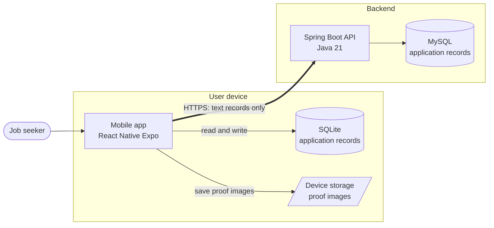
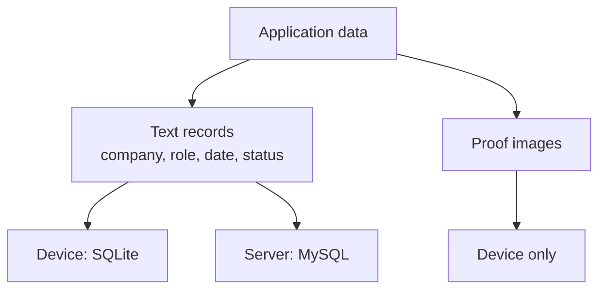

# ApplyProof

**Your applications. Your proof. Your device.**

A privacy-first job application tracker that helps you remember where you applied, when you applied, and what happened next.

---

## Table of Contents

1. [Problem Statement](#problem-statement)
2. [The Idea](#the-idea)
3. [Tech Stack](#tech-stack)
4. [System Design](#system-design)

---

## Problem Statement

When you are job hunting, you do not apply to one or two companies. You apply to dozens, across job portals, company career pages, emails and referrals.

The problem starts later. A recruiter calls, and you cannot remember:

- which company this is,
- which role you applied for,
- when you applied,
- or where you applied from.

There is no single place that answers "what did I apply to, and what is happening with it?" Browser history, emails and screenshots scattered across a phone gallery are not a system, and the missed context makes you sound unprepared at the exact moment it matters most.

ApplyProof was built to solve this problem.

## The Idea

ApplyProof is a mobile app where every job application is recorded in one place, with the company, role, location, date and time, and its current status. When a recruiter calls, you open the app and know where you stand within seconds.

You can also attach **proof of submission**, such as a screenshot of the confirmation page. Proof images are stored on your own device, not in the cloud, so personal documents and account pages are never uploaded anywhere. Only the text details of an application are synced to the server.

The app is **offline-first**: it works without an internet connection, and syncing happens in the background when you are online.

## Tech Stack

| Layer | Technology |
|---|---|
| Mobile app | React Native (Expo), TypeScript |
| Local storage | SQLite for records, device file system for proof images |
| Backend | Java 21, Spring Boot |
| Database | MySQL |
| Communication | REST API over HTTPS (JSON) |

## System Design

### Architecture overview

ApplyProof uses a **local-first** design. The mobile app is fully usable on its own, and the backend exists to keep the text records safe and available across devices.

### How the pieces fit together

| Component | Role |
|---|---|
| Mobile app | The interface for adding, searching and tracking applications |
| SQLite | Local source of truth, so the app works offline |
| Device storage | Holds proof images; they never leave the device |
| Spring Boot API | Receives and serves application records |
| MySQL | Central storage for application records, available across devices |

### Where data lives

| Data | On device | On server |
|---|---|---|
| Application details (company, role, location, date, status) | Yes | Yes |
| Proof images | Yes | **No** |

> **Core principle:** application details can be synchronized with the backend, but proof images stay on the user's device unless the user chooses to export or share them.

### Sync in brief

1. Every change is saved to SQLite first, so the app never waits on the network.
2. Pending changes are queued locally.
3. When the device is online, queued changes are sent to the backend and changes from other devices are fetched.
4. Only text records are transferred. The backend has no way to receive image files.
